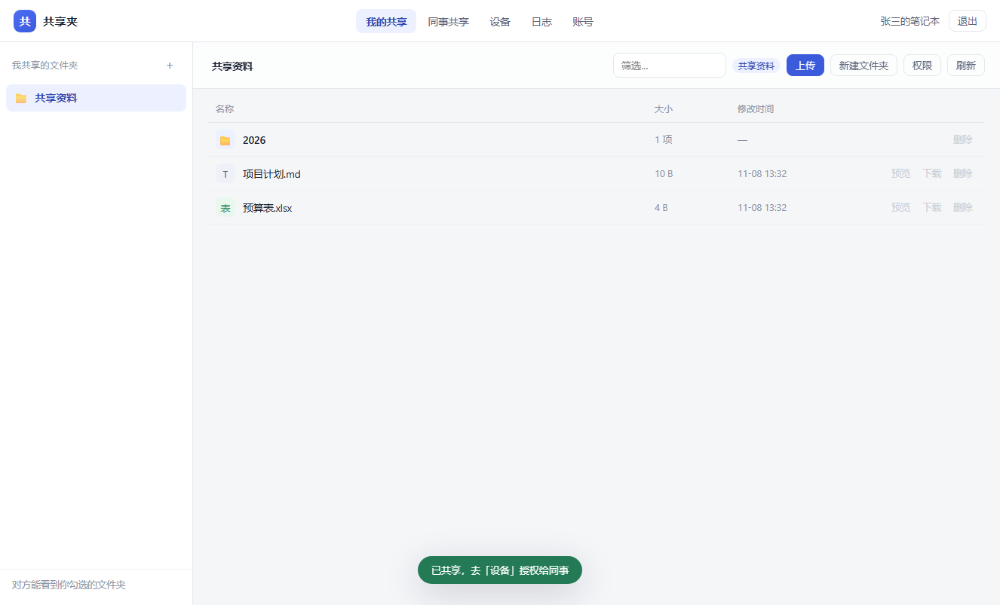
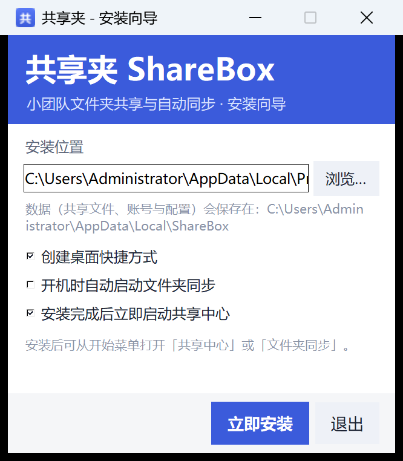
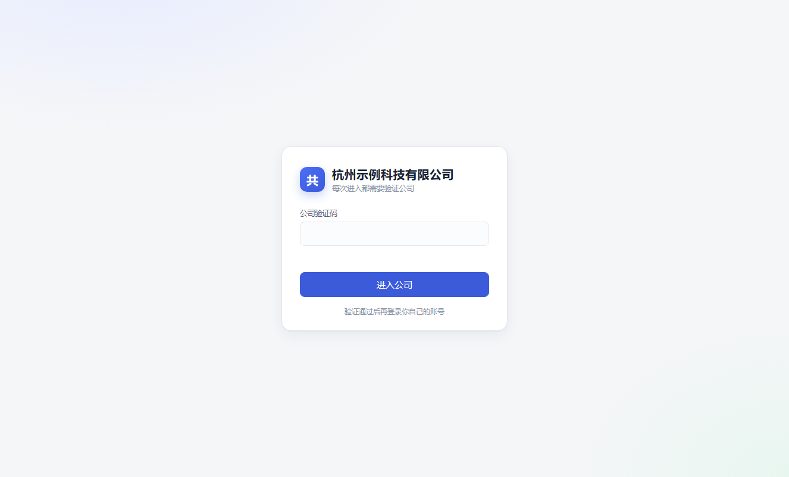
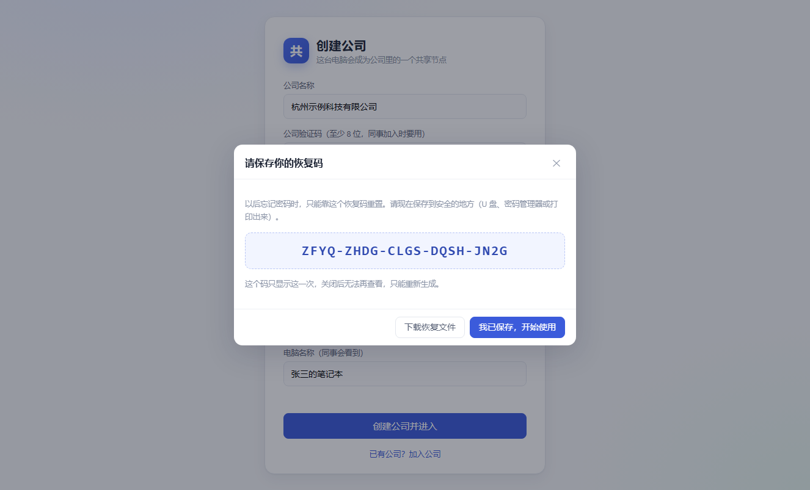
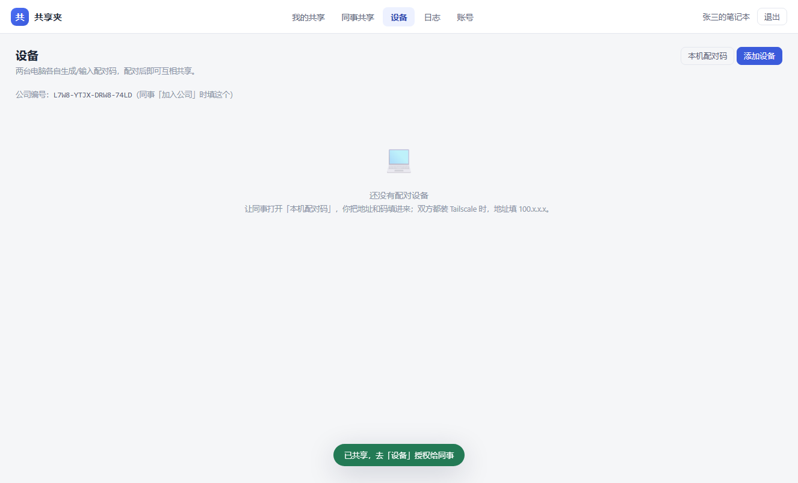
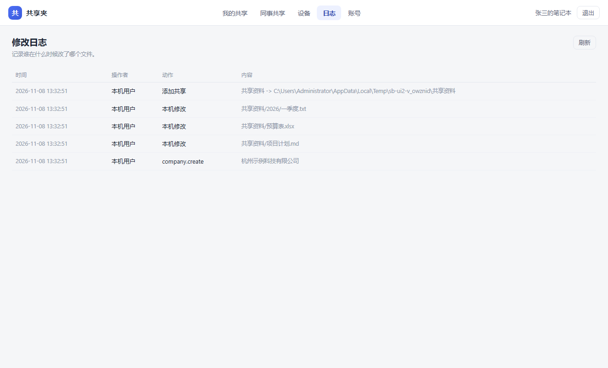

# ShareBox 共享夹（对等版 · 多公司）

给 2–5 人小团队用的 **点对点文件共享与自动同步**。两台电脑装同一个安装包，**没有服务器，也没有客户端**：

- 每个人把自己电脑上的一个文件夹共享出来；
- 对方能看到你共享的文件夹，并按你给的权限访问；
- 权限分 **只读** 和 **完全控制**，由共享方按设备设置；
- 所有修改都有日志：**谁、什么时候、改了哪个文件**；
- 忘记密码可以用 **恢复文件** 重置，不需要找管理员。

一个安装包可以给不同公司使用。每台电脑第一次先 **创建 / 加入公司**，以后每次进入都先 **验证公司**，再登录个人账号。**不同公司之间即使知道配对码也配不上、看不到对方文件。**



---

## 1. 公司（租户）是怎么隔离的

- 公司用 **公司编号 + 公司验证码** 标识，验证码只保存校验值，不保存明文；
- 每台电脑属于且只属于一个公司；
- 配对时双方要用 **公司密钥** 参与证明：公司不同，配对一定失败；
- 设备令牌和公司绑定，即使拿到某台设备的令牌也不能访问别家公司；
- 每次打开网页：先输入公司验证码（验证公司），再输入自己的账号密码。

> 一个安装只能属于一个公司。如果有人同时服务两家公司，用两台电脑或两个 Windows 用户各装一份。

---

## 1.1 先说清楚一个网络限制

两台笔记本各自在家庭宽带/公司网络后面时，互相没有公网地址，软件无法“凭空”找到对方。这是 NAT 决定的，任何 P2P 软件都一样。

所以跨网络时，双方需要先装一个免费的组网工具 **Tailscale**（2 分钟，不需要你们出服务器）。装好后两台电脑各有一个 `100.x.x.x` 地址，ShareBox 通过这个地址互相访问。

| 场景 | 需要做什么 |
| --- | --- |
| 同一办公室/同一路由器 | 不需要额外配置，填对方局域网 IP 即可 |
| 各自在家/外地 | 双方装 Tailscale，填 `100.x.x.x` |
| 严格只能装一个 exe | 只能在同一局域网内使用；异地无法直连 |

---

## 2. 安装

双击 **`ShareBox-Setup-2.1.7.exe`**：

1. 选择安装位置（默认 `%LOCALAPPDATA%\Programs\ShareBox`，普通用户权限即可）；
2. 按需勾选桌面快捷方式、开机自动启动；
3. 点「立即安装」。

装完开始菜单里会有：

| 快捷方式 | 用途 |
| --- | --- |
| 启动 ShareBox | 启动本机节点（黑窗口要保留），并自动打开网页 |
| 打开网页 | 直接打开 `http://127.0.0.1:8787` |
| 卸载 ShareBox | 卸载程序，默认保留数据 |

> 程序没有代码签名，首次运行 Windows 可能提示「已保护你的电脑」。
> 点「更多信息 → 仍要运行」即可。



---

## 3. 两台电脑怎么用（核心流程）

### 第 1 步：创建/加入公司，并创建个人账号

**公司创建者**（第一个人）：打开网页 → 填公司名称、公司验证码（至少 8 位）、自己的用户名和密码 → 「创建公司并进入」。

**其他同事**：打开网页 → 「已有公司？加入公司」→ 填 **公司编号**、**公司验证码**，再设置自己的用户名密码 → 加入。

> 公司编号和验证码由创建者告诉同事。公司编号在「设备」或「账号」页可以看到。

创建/加入成功后会显示一个 **恢复码**，请立刻点「下载恢复文件」保存。忘记密码时只能靠它重置。

**以后每次打开**：先输入公司验证码（验证公司），再输入自己的账号密码。





### 第 2 步：配对两台电脑

在 **A 电脑** 上：`设备` → `本机配对码`，会显示一个配对码和本机地址。

在 **B 电脑** 上：`设备` → `添加设备`，填写 A 的地址、端口 `8787`、配对码。

配对码 15 分钟内有效，用过即失效。**双方必须属于同一家公司**，否则会提示“不是同一家公司”或配对校验失败。



> 异地时地址填 Tailscale 的 `100.x.x.x`；同一局域网填 `192.168.x.x`。
> 第一次启动 Windows 防火墙会询问，选「允许专用网络」。

### 第 3 步：共享文件夹并授权

在 **A 电脑** 上：`我的共享` → 左上角 **＋**，填写显示名称和本地文件夹的完整路径（从资源管理器复制）。

然后在文件夹上点 **权限**，给 B 的设备选：

- **只读**：B 只能下载，不能改；
- **完全控制**：B 可以上传、修改、删除；
- **无权限**：看不到。

### 第 4 步：对方同步到本地

在 **B 电脑** 上：`同事共享` → 找到 A → `查看对方的共享` → 选择文件夹 → `同步到本地`，选一个本地保存目录。

之后 B 的电脑会定时把 A 的文件夹同步下来；如果是「完全控制」，B 在本地的修改也会传回 A。

---

## 4. 权限与同步规则

| 权限 | 浏览/下载 | 上传/修改/删除 |
| --- | --- | --- |
| 只读 | ✅ | ❌ |
| 完全控制 | ✅ | ✅ |

- 权限是 **按共享文件夹 + 按设备** 设置的，不是按文件。
- 共享方可以在任意时间改权限，下一轮同步生效。
- 只读方的本地修改不会被上传（可以自由改，但不会影响对方）。
- 两边同时改同一个文件时，保留两份：服务器版本落地，另一份改名 `xxx (冲突副本 设备名 时间).ext`，不会丢数据。
- 删除会双向传播；如果对方在你删除前刚改过这个文件，会以对方的新内容为准。

---

## 5. 修改日志

`日志` 页记录：

- 对方通过共享上传/修改/删除的文件（操作者显示为对方设备名）；
- 你本机对共享文件夹的修改（扫描器发现后记录）；
- 配对设备、添加共享、改权限等管理动作。



日志保存在本机数据库，不会上传。默认保留最近记录，可在 `日志` 页查看最近 300 条。

---

## 6. 忘记密码：恢复码

创建账号时会生成 **20 位恢复码**（形如 `SPJF-DVS6-DB5Y-Q97C-23UL`），并写入一个 `ShareBox-恢复码.txt`。

重置方式：登录页 → **忘记密码？用恢复文件重置** → 输入恢复码 → 设置新密码。

- 恢复码只保存哈希，程序自己也读不出来；
- 恢复码只显示一次，丢了就只能重新生成；
- 登录后可在 `账号 → 重新生成恢复码`，旧码立即失效。

---

## 7. 异地组网（Tailscale）

1. 两台电脑都安装 Tailscale：<https://tailscale.com/download>
2. 都登录同一个 Tailscale 账号（或同一个组织）；
3. 在 Tailscale 里看到对方的 `100.x.x.x` 地址；
4. 在 ShareBox 的「添加设备」里填这个地址，端口 `8787`；
5. 浏览器访问自己的 ShareBox 也仍然用 `http://127.0.0.1:8787`。

流量走 WireGuard 加密，不需要公网 IP、不需要改路由器。局域网内则直接用 `192.168.x.x`，不必装 Tailscale。

---

## 8. 数据、备份与迁移

所有数据都在 `%LOCALAPPDATA%\ShareBox`：

```
ShareBox\
  hub-data\
    sharebox.db       # 本机账号、共享索引、设备、日志、恢复码哈希
    files\            # 应用托管目录（本版一般不用）
    trash\            # 通过 ShareBox 删除的文件
    hub.log           # 运行日志
  mirrors\<编号>\     # 每个同步文件夹的增量状态
  edges\              # 浏览器缓存（Edge 无头测试用，可删）
```

**备份**：停止 ShareBox，复制整个 `%LOCALAPPDATA%\ShareBox` 即可。

**迁移到新电脑**：安装后用同一份数据目录覆盖，再启动；对端不需要改配置。

**注意**：共享的文件夹本身仍在你原来的位置，不在数据目录里；备份时要一起备份。

---

## 9. 安全设计

- 本机账号密码：PBKDF2-HMAC-SHA256（26 万次迭代 + 随机盐）；
- 公司验证码：PBKDF2 15 万次，只保存校验值；验证通过后用同一验证码派生公司密钥，仅保存在内存；
- 公司隔离：配对密钥 = HMAC(公司密钥, 配对码派生密钥)，不同公司即使拿到配对码也无法完成握手；设备令牌同时绑定公司编号；
- 公司验证：每次进入网页需先验证公司，验证后签发 12 小时有效的公司令牌，登录个人账号时必须携带；
- 设备配对：双方用配对码派生密钥（PBKDF2 12 万次），通过 HMAC 挑战应答验证，配对码不在网络上明文传输；
- 设备访问令牌：由配对密钥派生，保存在本机数据库，请求头携带，服务端常量时间比较；
- 配对码 15 分钟过期、一次性使用；配对/恢复/公司验证接口有频率限制；
- 所有文件路径做穿越校验，拒绝 `..`、绝对路径、盘符、非法字符；
- 网页带 CSP、`X-Frame-Options: DENY`、`nosniff`；
- 传输默认是 HTTP：请通过 Tailscale（已加密）或局域网使用；不要在公网直接暴露 8787。

---

## 10. 命令行 / 自己打包

免安装运行（需要 Python 3.9+）：

```bat
python sb.py hub                 # 启动本机节点（默认 8787）
python sb.py hub --port 9000     # 换端口，同事配对时端口也要改
python sb.py hub --admin owner --admin-password Owner1234 ^
    --company-name "我的公司" --company-code "Company123"   # 非交互初始化（IT 部署）
```

自己打包安装程序（需要 Python + 网络）：

```bat
build-installer.bat
```

产物是 `dist\ShareBox-Setup.exe`，双击即图形安装向导。

静默安装（IT 批量部署）：

```bat
ShareBox-Setup.exe --install-silent --target D:\Apps\ShareBox
ShareBox-Setup.exe --uninstall-silent
```

---

## 11. 常见问题

**Q：一定要装 Tailscale 吗？**
同一局域网不用；异地必须有一个办法让两台电脑互相可达，Tailscale 是免费且最简单的。

**Q：公司验证码忘了怎么办？**
验证码只保存校验值，无法找回。请找公司创建者要；创建者自己也丢了的话，只能重建公司并重新配对（磁盘上的文件不会丢）。建议创建时把「公司编号 + 验证码」和恢复码一起抄下来。

**Q：不同公司的人能配对吗？**
不能。配对证明里混入了公司密钥，公司编号不一致会直接拒绝，即使知道配对码也不行。

**Q：一个人能加入多个公司吗？**
一个安装只能属于一个公司。需要同时服务两家公司时，用另一台电脑或另一个 Windows 用户各装一份。

**Q：配对时提示连不上对方？**
按顺序检查：对方 ShareBox 是否在运行 → 地址和端口是否填对 → Windows 防火墙是否放行 → 双方是否在同一 Tailscale 网络。

**Q：对方看不到我共享的文件夹？**
先确认双方是同一家公司，再配对；然后在「我的共享 → 权限」里给对方设备授权，只配对不授权是看不到的。

**Q：改了文件多久同步？**
本机扫描约 8 秒，对方拉取约 7 秒，通常 15 秒内；文件被 Office 占用时会等下一轮。

**Q：共享文件夹被删了会怎样？**
ShareBox 只移除共享关系，不会删你磁盘上的文件夹；通过 ShareBox 删除的文件会进 `trash\`。

**Q：关掉黑窗口会怎样？**
对端立刻连不上你；你本机文件不受影响。需要时重新启动即可。

---

## 12. 测试

```bash
python -m unittest discover -s tests -t . -v   # 46 项：路径/密码/权限/API/同步/公司隔离/对等配对
python tools/frozen_peer_check.py              # 打包后的两个 exe 实跑配对与同步
python tools/ui_check.py                      # Edge 无头渲染界面并截图
```

对等模式测试覆盖：配对握手、错误配对码、共享授权、只读拒写、扫描同步、双向回写、日志记录、恢复码重置。

---

## 13. 已知限制

- 需要双方网络可达（局域网或 Tailscale）；没有自建中转。
- 权限到文件夹，不支持单文件 ACL。
- 不做文件内容合并，冲突保留副本。
- 本地新建的空目录不会单独同步（放入文件后同步）。
- 共享数量、文件数量面向文档型小团队；几十万小文件会变慢。

---

## 16. 开源与签名

- 许可证：**Apache-2.0**（见 `LICENSE`）。
- 构建：`scripts/build-windows.ps1`，在干净的 Windows + Python 3.12 上可复现。
- CI：`.github/workflows/windows-build.yml` 构建安装包；`signpath-release.yml` 预留了 SignPath 签名步骤。
- 公开可信签名：按 `docs/SIGNPATH.md` 申请 **SignPath Foundation**（开源项目免费），发布者显示为 SignPath Foundation。
- 内部自签名：`signing/` 下的证书与脚本只用于受控电脑，**不要提交到公开仓库**。
- 安全约定见 `SECURITY.md`：仓库中不得出现 Tailscale key、私钥、用户数据。